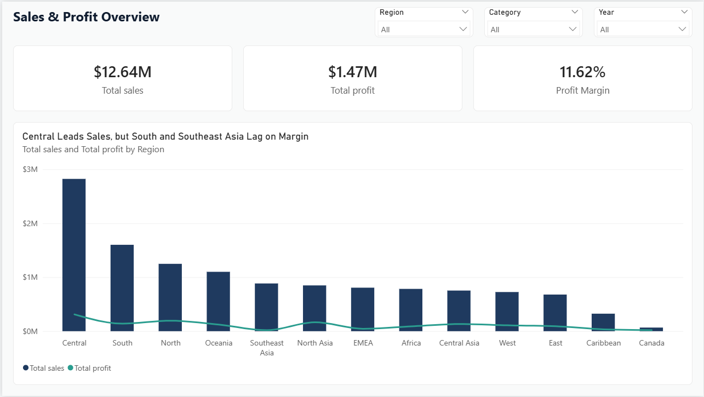
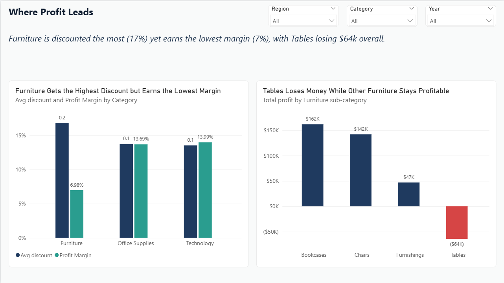
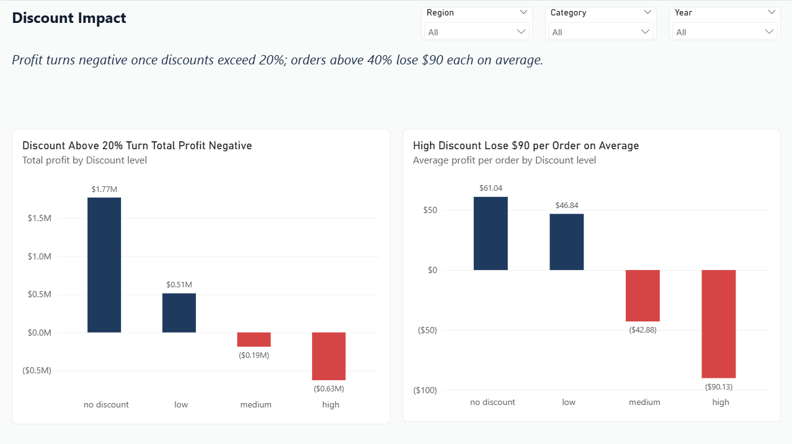
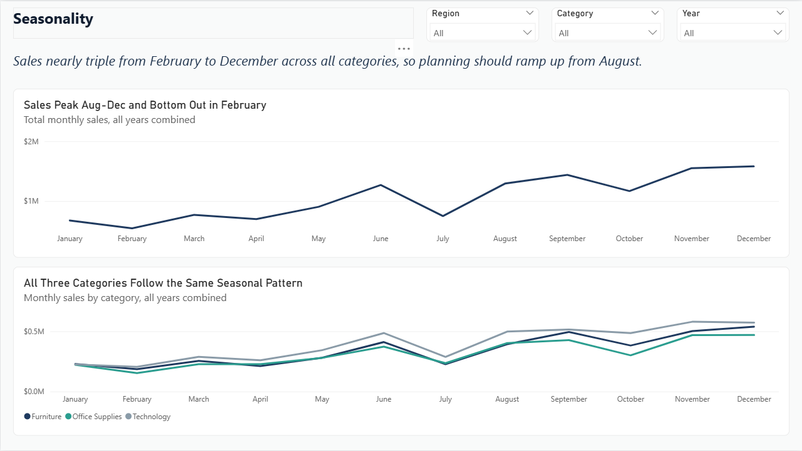

# Global Superstore Sales Analysis | SQL + Power BI

An end-to-end business analysis of **51,290 retail orders** from a global superstore, built to answer one core question: **where is the business making money, and where is it losing it?**

Using MySQL for analysis and Power BI for an interactive dashboard, the project uncovers a loss-making product line, a clear discount threshold beyond which orders become unprofitable, and a strong seasonal sales pattern.



📄 **[View the full dashboard (PDF)](dashboard/PowerBI_dashboard.pdf)**
---

## Business Questions

**Profitability**
1. Which regions are high in sales but low in profit?
2. Which product categories are actually losing money?

**Discounting**

3. Is there a relationship between discount level and profit?
4. Which categories are over-discounted relative to their profit margin?

**Seasonality**

5. Which months have the highest and lowest sales?
6. Are some categories seasonal while others stay flat?

---

## Dataset

- **Source:** Global Superstore dataset (Kaggle)
- **Size:** 51,290 rows, 21 columns
- **Key fields:** order and ship dates, region, market, category, sub-category, sales, quantity, discount, profit, shipping cost, order priority
- **Currency:** not specified in the source; presented in US dollars

---

## Tools and Methods

| Stage | Tool | What was done |
|---|---|---|
| Data check | Excel | Checked data types, duplicates and missing values |
| Data import | MySQL | Created schema, converted date formats, cleaned comma-formatted numbers |
| Analysis | MySQL | Aggregations, profit margin ratios, CASE WHEN discount banding, date extraction |
| Dashboard | Power BI | DAX calculated column and measure, conditional formatting, synced slicers |

---

## Technical Highlights

**DAX calculated column**: banding discounts for analysis
```dax
Discount Range =
SWITCH(
    TRUE(),
    superstore_sales[discount] = 0, "No Discount",
    superstore_sales[discount] <= 0.2, "Low",
    superstore_sales[discount] <= 0.4, "Medium",
    "High"
)
```

**DAX measure**: profit margin that recalculates correctly under any filter
```dax
Profit Margin = DIVIDE(SUM(superstore_sales[profit]), SUM(superstore_sales[sales]), 0)
```

**Data cleaning in SQL**: converting text dates and comma-formatted numbers on import
```sql
SET order_date = STR_TO_DATE(@order_date, '%d-%m-%Y'),
    sales      = REPLACE(@sales, ',', '');
```

---

## Key Findings

### 1. High sales do not always mean high profit
Central leads in both sales ($2.82M) and profit. But **South is 2nd in sales with only a 9% margin**, and **Southeast Asia converts just 2% of sales into profit**. Canada has the lowest sales but the highest margin (27%).

### 2. A loss-making product hides inside a profitable category
No category is negative overall, but Furniture is the weakest. Drilling down shows **Tables lose about $64K**, while Chairs and Bookcases stay profitable enough to mask the loss at category level.

### 3. Discounts above 20% make orders unprofitable

| Discount band | Total profit | Avg profit per order |
|---|---|---|
| No discount | $1,770,695 | $61.04 |
| Low (up to 20%) | $513,022 | $46.84 |
| Medium (20–40%) | -$187,271 | -$42.88 |
| High (above 40%) | -$627,411 | -$90.13 |

Profit does not just shrink as discounts rise. It **turns negative past roughly 20%**, and high-discount orders lose $90 each on average.

### 4. Furniture is over-discounted

| Category | Profit margin | Avg discount |
|---|---|---|
| Furniture | 7% | 17% |
| Office Supplies | 14% | 14% |
| Technology | 14% | 14% |

Furniture receives the highest discount yet earns half the margin of the other categories, linking findings 2 and 3.

### 5. Sales follow a strong seasonal cycle
Sales are lowest January–April and highest August–December. **December ($1.58M) is nearly 3x February ($0.54M)**.

### 6. Seasonality is business-wide, not category-specific
All three categories rise and fall in the same months, suggesting demand is driven by general shopping periods rather than product type. The size of the swing differs by category.

---

## Recommendations

1. **Review the discount policy.** Treat discounts above 20% as an exception requiring approval, since they are loss-making on average.
2. **Investigate Tables.** Review pricing, discounting and shipping costs for this sub-category before it erodes Furniture further.
3. **Audit South and Southeast Asia.** Both regions generate strong revenue but weak margins; costs and discount practices there need a closer look.
4. **Plan for the season from August, not November.** Inventory, staffing and marketing should scale up at the start of the high season across all categories.

---

## Dashboard

An interactive 4-page Power BI report with Region, Category and Year slicers synced across all pages.

| Page | Focus |
|---|---|
| Overview | KPI cards and regional sales vs profit |
| Where Profit Leaks | Category margins and Furniture sub-category losses |
| The Cost of Discounting | Profit by discount band |
| Seasonal Sales Patterns | Monthly trends, overall and by category |





---

## Repository Structure

```
├── sql/          SQL scripts: database setup and analysis for all 6 questions
├── dashboard/    Power BI file (.pbix) and PDF export
├── images/       Dashboard screenshots
└── README.md
```

---

## Limitations

- Months are combined across all years, so the seasonality view shows a typical year rather than year-on-year change.
- The discount findings show a strong association with lower profit, not proof of cause; other factors such as product mix could contribute.
- The source data does not state a currency; US dollars are assumed.

---

## About Me

**Diya Chakraborty** — transitioning into Business Intelligence Analytics with a postgraduate background in Industrial/Organisational Psychology.

[LinkedIn](https://www.linkedin.com/in/diya-chakraborty-2b0948210)
